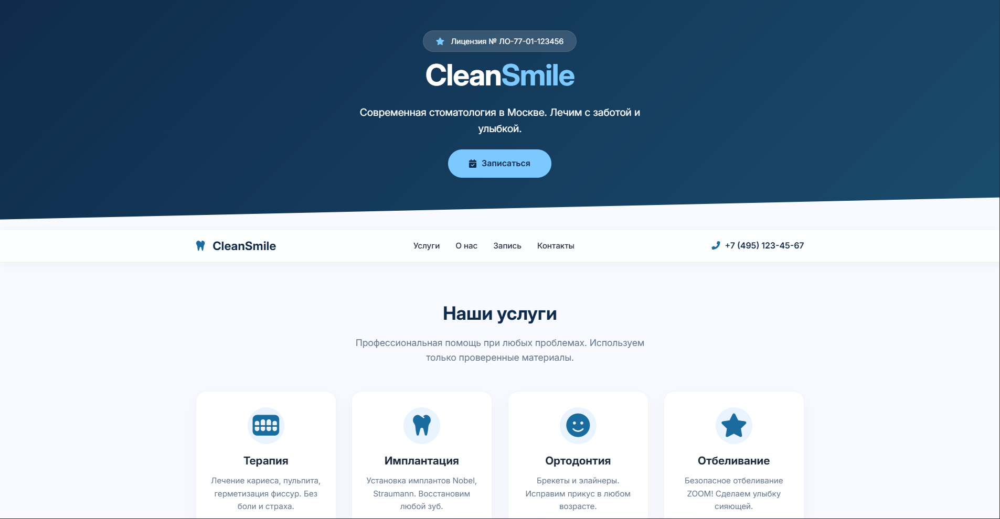
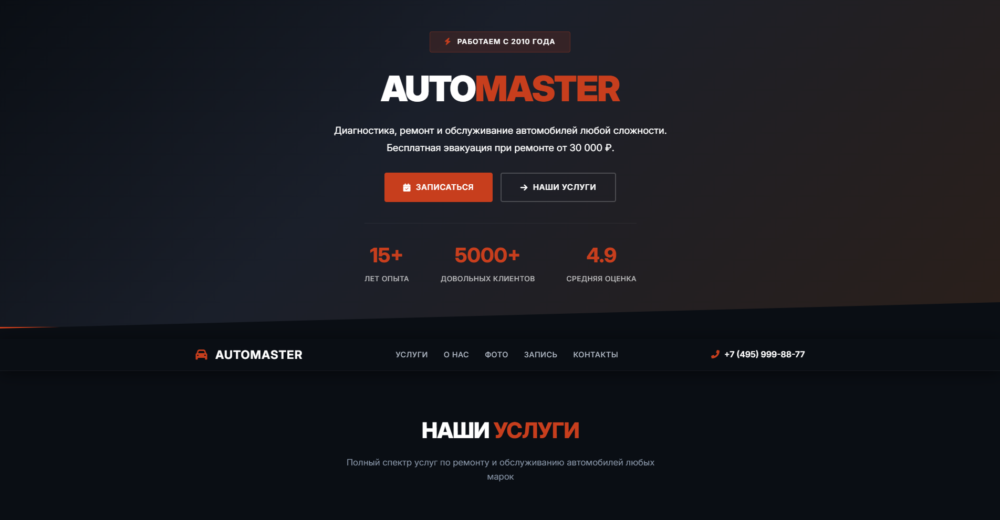
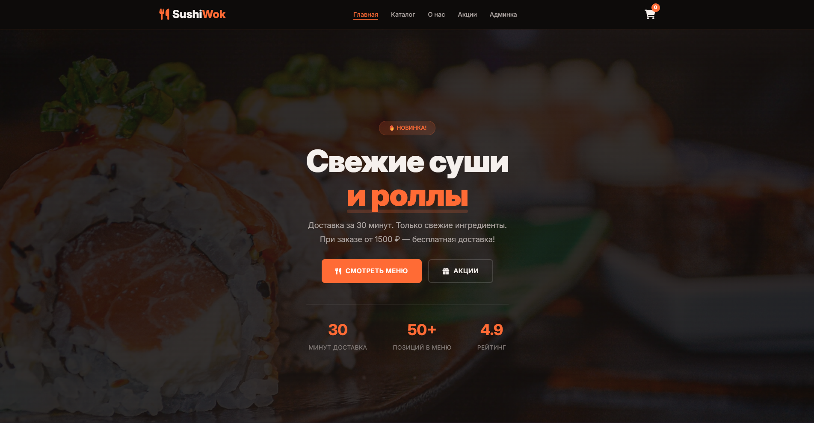
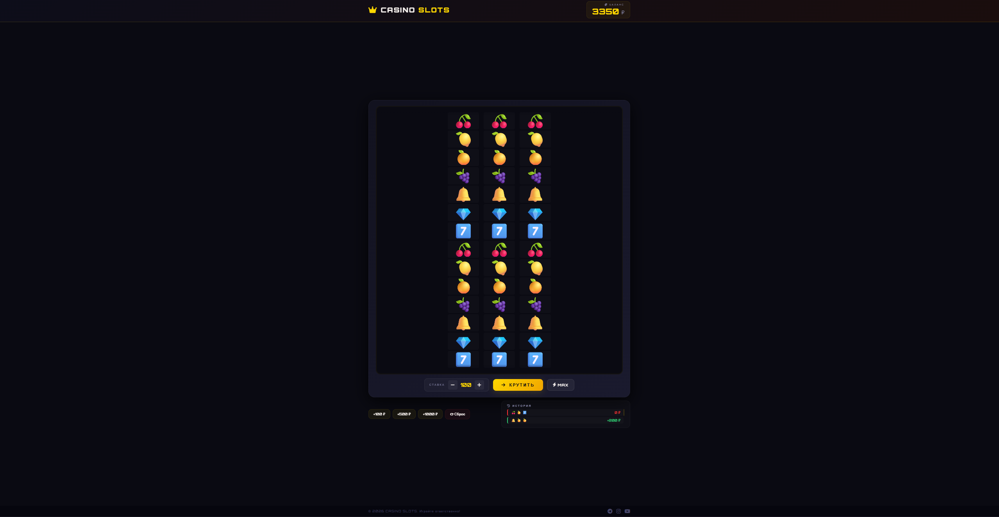
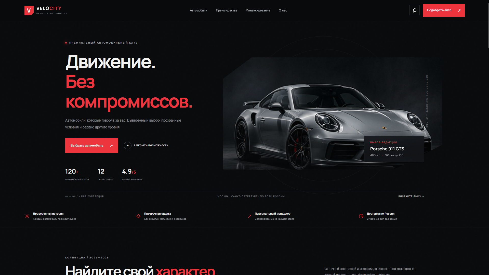
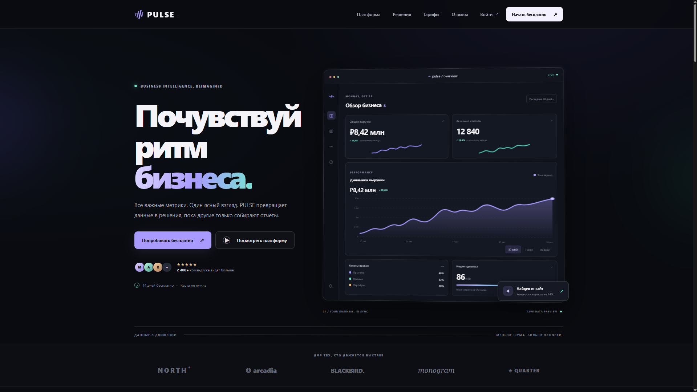
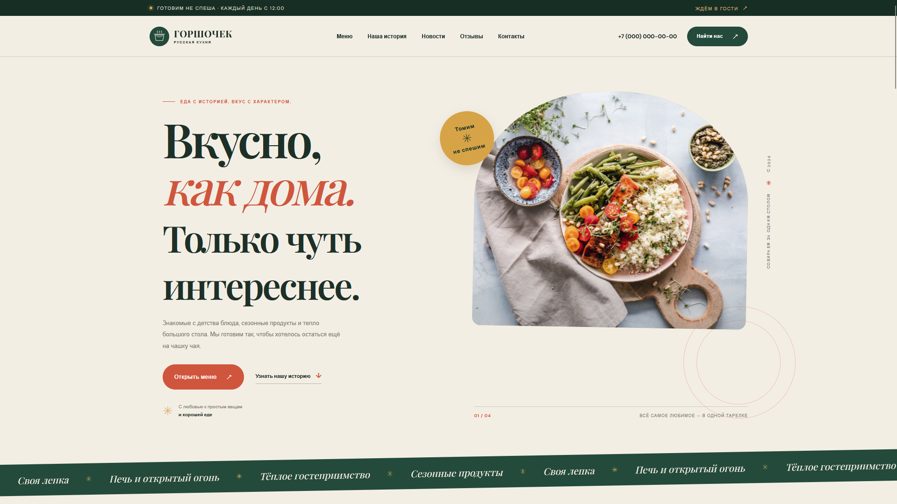

<div align="center">

# 🎯 Web Works

### Портфолио веб-разработчика • Web Developer Portfolio


**7 проектов. 7 направлений. 7 разных визуальных стилей.**  
**7 projects. 7 industries. 7 distinct visual styles.**

</div>

---

## 📖 О репозитории • About

**Русский**

**Web Works** — коллекция из семи веб-проектов для разных сфер: стоматология, автосервис, премиальный автомобильный шоурум, суши-ресторан, слот-игра, SaaS-концепт бизнес-аналитики и сайт ресторана русской кухни с серверной частью.

У каждого проекта собственная визуальная система и набор функций. В репозитории есть светлый минималистичный сайт клиники, брутальный сайт автосервиса, премиальный тёмный шоурум **VELOCITY**, интерактивный каталог суши с корзиной и демо-админкой, слот-игра с балансом и историей вращений, премиальный тёмный **PULSE** — концепт платформы бизнес-аналитики с интерактивным дашбордом и анимациями — и **ГОРШОЧЕК**, современный сайт ресторана русской кухни с меню на SQLite и полноценной админ-панелью.

**English**

**Web Works** is a collection of seven web projects for different industries: a dental clinic, an auto service, a premium automotive showroom, a sushi restaurant, a slot game, a business intelligence SaaS concept, and a Russian cuisine restaurant website with a backend.

Each project has its own visual style and feature set. The repository includes a light minimalist clinic website, a bold auto service website, the premium dark **VELOCITY** showroom, an interactive sushi menu with a cart and demo admin panel, a slot game with balance and spin history, **PULSE**, a premium dark business intelligence SaaS concept with an interactive dashboard and motion effects, and **ГОРШОЧЕК**, a modern Russian cuisine restaurant website with a SQLite-backed menu and a full admin panel.

---

## 📸 Скриншоты • Screenshots

| 🦷 CleanSmile | 🚗 AutoMaster | 🍣 SushiWok |
|---|---|---|
|  |  |  |

| 🎰 Casino Slots | 🚗 VELOCITY | 📊 PULSE |
|---|---|---|
|  |  |  |


| 🍛 Gorshochek |
|---|
|  |

---

## 📁 Проекты • Projects

### 🦷 1. CleanSmile — Сайт стоматологии • Dental Clinic

Светлый и аккуратный сайт стоматологической клиники с акцентом на доверие, понятную подачу услуг и запись на приём.

*A clean, light dental clinic website focused on trust, clear service information, and appointment booking.*

| 🇷🇺 Русский | 🇬🇧 English |
|---|---|
| 🏥 Светлый минималистичный дизайн | 🏥 Light minimalist design |
| ✨ Плавные анимации при прокрутке | ✨ Smooth scroll animations |
| 📝 Форма записи с валидацией | 📝 Appointment form with validation |
| 📱 Адаптивная вёрстка | 📱 Responsive layout |

**Папка проекта • Project folder:** [`dental/`](dental/)

---

### 🚗 2. AutoMaster — Сайт автосервиса • Auto Service

Сайт автосервиса с брутальным тёмным оформлением и оранжевыми акцентами.

*An auto service website with a bold dark design and orange accents.*

| 🇷🇺 Русский | 🇬🇧 English |
|---|---|
| ⚫ Тёмный брутальный стиль | ⚫ Bold dark visual style |
| 🟠 Оранжевый акцентный цвет | 🟠 Orange accent color |
| 🖼️ Галерея работ с оверлеем | 🖼️ Work gallery with overlays |
| 🗺️ Интерактивная карта при настроенном API | 🗺️ Interactive map when API is configured |
| 📊 Статистика в шапке | 📊 Header statistics |

**Папка проекта • Project folder:** [`auto/`](auto/)

---

### 🏎️ 3. VELOCITY — Premium Automotive

Премиальный автомобильный шоурум с тёмным интерфейсом, красными акцентами и интерактивным каталогом. Проект помогает изучать автомобили, сравнивать варианты и оценивать примерные условия финансирования.

*A premium automotive showroom with a dark interface, red accents, and an interactive vehicle catalog. Visitors can explore vehicles, compare options, and estimate financing scenarios.*

| 🇷🇺 Русский | 🇬🇧 English |
|---|---|
| 🖤 Премиальный тёмный дизайн с красными акцентами | 🖤 Premium dark design with red accents |
| 🚘 Каталог автомобилей | 🚘 Vehicle catalog |
| 🔎 Поиск и фильтры по категории, марке и бюджету | 🔎 Search and filters by category, brand, and budget |
| ↕️ Сортировка автомобилей | ↕️ Vehicle sorting |
| ❤️ Избранное с сохранением в браузере | ❤️ Favorites saved in the browser |
| ⚖️ Сравнение до трёх автомобилей | ⚖️ Compare up to three vehicles |
| 💳 Калькулятор кредита и лизинга | 💳 Loan and lease calculator |
| 🖼️ Галерея автомобилей с переключением изображений | 🖼️ Vehicle image gallery with navigation |
| 🛠️ Демо-инструменты управления каталогом | 🛠️ Demo catalog management tools |
| 📩 Демо-форма заявки на тест-драйв | 📩 Demo test-drive inquiry form |
| 📱 Адаптивная вёрстка и мобильная навигация | 📱 Responsive layout and mobile navigation |

**Папка проекта • Project folder:** [`velocity/`](velocity/)

---

### 🍣 4. SushiWok — Сайт суши-ресторана • Sushi Restaurant

Сайт суши-ресторана с каталогом блюд, корзиной и отдельной демо-админкой для управления позициями меню.

*A sushi restaurant website with a dish catalog, shopping cart, and a separate demo admin panel for managing menu items.*

| 🇷🇺 Русский | 🇬🇧 English |
|---|---|
| 🍣 Каталог с фильтрацией | 🍣 Filterable menu catalog |
| 🛒 Корзина с подсчётом стоимости | 🛒 Shopping cart with price totals |
| 🔐 Демо-админ-панель | 🔐 Demo admin panel |
| 📦 CRUD-операции с товарами | 📦 CRUD product management |
| 💾 Локальное хранение данных через `localStorage` | 💾 Local data storage with `localStorage` |
| 🌙 Тёмная тема со стеклянными эффектами | 🌙 Dark theme with glass effects |

**Папка проекта • Project folder:** [`sushiwok/`](sushiwok/)

---

### 🎰 5. Casino Slots — Игровой слот • Slot Game

Интерактивная слот-игра с тремя барабанами, регулируемой ставкой, демонстрационным балансом и историей последних вращений.

*An interactive slot game with three reels, adjustable bets, a demo balance, and recent spin history.*

| 🇷🇺 Русский | 🇬🇧 English |
|---|---|
| 🎡 Три барабана и семь символов | 🎡 Three reels and seven symbols |
| 💰 Баланс с сохранением | 💰 Persistent balance |
| 🎲 Настройка размера ставки | 🎲 Bet adjustment |
| 🏆 Выигрыши с множителями | 🏆 Wins with multipliers |
| 💵 Демонстрационное пополнение баланса | 💵 Demo balance top-up |
| 📜 История последних вращений | 📜 Recent spin history |
| ⌨️ Управление с клавиатуры | ⌨️ Keyboard controls |

**Папка проекта • Project folder:** [`slots/`](slots/)

### 📊 6. PULSE — Business Intelligence SaaS Concept

Премиальный тёмный лендинг концептуальной платформы бизнес-аналитики. PULSE показывает, как может выглядеть продукт, который собирает ключевые метрики в одном интерфейсе и помогает командам быстрее переходить от данных к решениям.

*A premium dark landing page for a conceptual business intelligence platform. PULSE demonstrates a product experience that brings key metrics together and helps teams move from data to decisions.*

| 🇷🇺 Русский | 🇬🇧 English |
|---|---|
| 🖤 Премиальный тёмный интерфейс с фиолетовыми и мятными акцентами | 🖤 Premium dark interface with violet and mint accents |
| 📈 Интерактивный макет дашборда и переключение периода графика | 📈 Interactive dashboard mockup and chart period switching |
| 🧭 Вкладки решений с обновлением KPI и визуализаций | 🧭 Solution tabs that update KPIs and visualizations |
| 💳 Переключатель ежемесячной и годовой оплаты | 💳 Monthly and yearly billing toggle |
| 💬 Карусель отзывов и FAQ-аккордеон | 💬 Testimonial carousel and FAQ accordion |
| 📱 Адаптивная мобильная навигация | 📱 Responsive mobile navigation |
| ✨ Анимации появления при прокрутке и последовательное появление элементов hero-блока | ✨ Scroll-reveal animations and staggered hero entrance |
| ♿ Уважение `prefers-reduced-motion` | ♿ Respects `prefers-reduced-motion` |
| 📝 Форма с валидацией и локальным демо-подтверждением | 📝 Validated form with local demo confirmation |
| ⚡ Чистые HTML, CSS и JavaScript без сборщика и сторонних JS/CSS-библиотек | ⚡ Vanilla HTML, CSS, and JavaScript; no build step or third-party JS/CSS libraries |

> **Важно • Important:** PULSE — портфолио-концепт. Метрики, тарифы и отзывы демонстрационные; форма не отправляет данные на сервер. Для настоящего сервиса потребуются backend, авторизация, хранение данных и биллинг.
>
> PULSE is a portfolio concept. Metrics, pricing, and testimonials are illustrative; the form does not submit data to a server. A real service would require a backend, authentication, data storage, and billing.

**Папка проекта • Project folder:** [`pulse/`](pulse/)

### 🍲 7. ГОРШОЧЕК — Ресторан русской кухни • Russian Cuisine Restaurant

Современный сайт ресторана русской кухни с тёплым визуальным стилем, меню, новостями и отдельной админ-панелью. В отличие от статических проектов репозитория, **ГОРШОЧЕК** использует backend на Node.js и хранит данные в SQLite.

*A modern Russian cuisine restaurant website with a warm visual identity, menu, news, and a dedicated admin panel. Unlike the static projects in this repository, **ГОРШОЧЕК** uses a Node.js backend and stores its data in SQLite.*

| 🇷🇺 Русский | 🇬🇧 English |
|---|---|
| 🍽️ Меню с категориями, ценами, весом и описаниями блюд | 🍽️ Menu with categories, prices, weights, and dish descriptions |
| 🗄️ Хранение меню, новостей и настроек в SQLite | 🗄️ SQLite storage for menu items, news, and settings |
| 🔐 Админ-панель с авторизацией | 🔐 Authenticated admin panel |
| ✏️ Добавление, редактирование, удаление и скрытие блюд | ✏️ Add, edit, delete, and hide dishes |
| 📰 Создание новостей и управление публикациями | 📰 Create news and manage publication status |
| ⚙️ Настройки адреса, телефона и часов работы | ⚙️ Address, phone number, and opening-hours settings |
| 🗺️ Интеграция с Яндекс Картами через JavaScript API 2.1 | 🗺️ Yandex Maps integration via JavaScript API 2.1 |
| ⭐ Место под виджет отзывов Яндекса | ⭐ Configurable Yandex Reviews widget |
| 🛡️ Серверные сессии, хеширование паролей и базовая защита запросов | 🛡️ Server-side sessions, password hashing, and request protection |
| 📱 Адаптивная вёрстка | 📱 Responsive layout |

> **Важно • Important:** изображения блюд и новостей задаются URL-адресами. Онлайн-заказы, бронирование столиков и оплата пока не реализованы. Яндекс Карты требуют собственного API-ключа; отзывы подключаются через URL виджета из настроек ресторана.
>
> Dish and news images are provided as URLs. Online ordering, table reservations, and payments are not implemented. Yandex Maps requires your own API key; reviews are embedded using the widget URL configured in restaurant settings.

**Папка проекта • Project folder:** [`gorshochek/`](gorshochek/) · [README проекта](gorshochek/README.md)

---

## 🛠️ Технологии • Tech Stack

| Технология • Technology | Использование • Purpose |
|---|---|
| **HTML5 / CSS3 / JavaScript (ES6+)** | Структура, адаптивный дизайн, анимации и интерактивность • Structure, responsive styling, motion, and interactivity |
| **Node.js 22+** | Серверная среда для ГОРШОЧКА • Server runtime for GORSHOCHEK |
| **Express** | HTTP-сервер и REST API • HTTP server and REST API |
| **SQLite + `better-sqlite3`** | Хранение меню, новостей, настроек и сессий • Storage for menu, news, settings, and sessions |
| **`express-session` + `bcryptjs`** | Сессии администратора и хеширование паролей • Admin sessions and password hashing |
| **Helmet + `express-rate-limit`** | Заголовки безопасности и ограничение частоты входа • Security headers and login rate limiting |
| **`dotenv`** | Конфигурация сервера через `.env` • Server configuration through `.env` |
| **`localStorage`** | Локальное сохранение данных в проектах, где предусмотрено • Local persistence where implemented |
| **Font Awesome / Google Fonts** | Иконки и веб-шрифты в проектах, где подключены • Icons and web fonts where included |
| **Yandex Maps API 2.1** | Интерактивные карты и виджет отзывов там, где настроены • Interactive maps and reviews widget where configured |

Большинство проектов — статические сайты на HTML, CSS и JavaScript: их можно открыть напрямую или через Live Server. **ГОРШОЧЕК** — отдельное full-stack приложение: для него нужны Node.js, установка npm-зависимостей и запуск Express-сервера.

Most projects are static HTML, CSS, and JavaScript websites and can be opened directly or through Live Server. **ГОРШОЧЕК** is a separate full-stack application that requires Node.js, npm dependencies, and an Express server.

---

## 🚀 Запуск проектов • Running the Projects

### 🇷🇺 Русский

1. Скачай или клонируй репозиторий.
2. Для `dental/`, `auto/`, `velocity/`, `sushiwok/`, `slots/` и `pulse/` открой `index.html` в современном браузере или используй **Live Server**.
3. **ГОРШОЧЕК** запускается отдельно через Node.js: перейди в `gorshochek/`, установи зависимости командой `npm install`, создай `.env` на основе `.env.example` и выполни `npm run dev`.
4. После запуска ГОРШОЧКА открой `http://localhost:3000`; админ-панель находится по адресу `http://localhost:3000/admin`.
5. Внешние карты, виджеты и веб-шрифты могут требовать подключения к интернету и собственных ключей/настроек.

### 🇬🇧 English

1. Download or clone the repository.
2. For `dental/`, `auto/`, `velocity/`, `sushiwok/`, `slots/`, and `pulse/`, open `index.html` in a modern browser or use **Live Server**.
3. **ГОРШОЧЕК** runs separately with Node.js: enter `gorshochek/`, install dependencies with `npm install`, create `.env` from `.env.example`, and run `npm run dev`.
4. Once GORSHOCHEK is running, open `http://localhost:3000`; the admin panel is at `http://localhost:3000/admin`.
5. External maps, widgets, and web fonts may require an internet connection and your own keys/settings.

---

## 📦 Установка • Installation

```bash
# Clone the repository
git clone https://github.com/kiru0real/web-works.git

# Enter the repository
cd web-works
```

Для статических проектов выбери папку и открой её `index.html`. Например, для PULSE:

For a static project, choose its folder and open `index.html`. For example, for PULSE:

```bash
cd pulse
```

#### ГОРШОЧЕК • GORSHOCHEK (Node.js)

Требуется **Node.js 22 или новее**. Команды ниже выполняются из корня репозитория:

Node.js **22 or newer** is required. Run the following commands from the repository root:

```powershell
cd gorshochek
npm install
Copy-Item .env.example .env
```

Открой `.env` и задай длинный случайный `SESSION_SECRET`. При желании укажи `ADMIN_USERNAME`, `ADMIN_PASSWORD` и `YANDEX_MAPS_API_KEY`. Затем запусти сервер:

Open `.env` and set a long random `SESSION_SECRET`. Optionally configure `ADMIN_USERNAME`, `ADMIN_PASSWORD`, and `YANDEX_MAPS_API_KEY`. Then start the server:

```bash
npm run dev
```

- Сайт • Website: `http://localhost:3000`
- Админ-панель • Admin panel: `http://localhost:3000/admin`

При первом запуске создаются база `data/gorshochek.sqlite`, стартовые блюда и новости. Если `ADMIN_PASSWORD` не задан или оставлен placeholder, сгенерированный пароль администратора выводится в консоль. Сохрани его. Настройки логина и пароля из `.env` применяются только при первом создании администратора.

On first launch, the app creates `data/gorshochek.sqlite`, sample dishes, and news. If `ADMIN_PASSWORD` is missing or left as the placeholder, a generated admin password is printed in the console. Save it. Admin credentials from `.env` are used only when the admin account is first created.

---

## 🗺️ Настройка API-ключей • API Key Setup

AutoMaster и SushiWok могут использовать **Yandex Maps API**, если интеграция настроена. В **ГОРШОЧКЕ** ключ JavaScript API задаётся через `YANDEX_MAPS_API_KEY` в `gorshochek/.env`; адрес и координаты ресторана редактируются в админ-панели. PULSE не требует внешних API-ключей.

AutoMaster and SushiWok may use **Yandex Maps API** when the integration is configured. In **ГОРШОЧЕК**, the JavaScript API key is set through `YANDEX_MAPS_API_KEY` in `gorshochek/.env`; the restaurant address and coordinates are edited in the admin panel. PULSE does not require external API keys.

1. Перейди на [Yandex Maps Developer](https://developer.tech.yandex.ru/) и получи ключ для JavaScript API 2.1.
2. Добавь ключ в `gorshochek/.env` как `YANDEX_MAPS_API_KEY=...`.
3. В админ-панели ГОРШОЧКА укажи реальный адрес и координаты широты/долготы.
4. Ограничь ключ по HTTP Referer в кабинете Яндекса. Не публикуй `.env` и серверные секреты в репозитории.
5. Для отзывов открой карточку организации в Яндекс Картах → «Поделиться» → «Виджет с отзывами», скопируй URL `src` из iframe и вставь его в поле виджета в настройках ресторана.

1. Visit [Yandex Maps Developer](https://developer.tech.yandex.ru/) and obtain a JavaScript API 2.1 key.
2. Add it to `gorshochek/.env` as `YANDEX_MAPS_API_KEY=...`.
3. In the GORSHOCHEK admin panel, enter the real address and latitude/longitude coordinates.
4. Restrict the key by HTTP Referer in the Yandex Developer Dashboard. Do not commit `.env` or server secrets.
5. To display reviews, open the organization card in Yandex Maps → “Share” → “Reviews widget”, copy the iframe `src` URL, and paste it into the reviews-widget field in restaurant settings.

Пример подключения • Example integration:

```html
<script src="https://api-maps.yandex.ru/2.1/?apikey=YOUR_API_KEY&lang=ru_RU" type="text/javascript"></script>
```

---

## 📂 Структура репозитория • Repository Structure

```text
web-works/
├── README.md
├── LICENSE
├── dental/
│   ├── index.html
│   ├── style.css
│   └── script.js
├── auto/                       # AutoMaster — auto service
│   ├── index.html
│   ├── style.css
│   ├── script.js
│   └── img/
├── velocity/                   # VELOCITY — Premium Automotive
│   ├── index.html
│   ├── styles.css
│   ├── app.js
│   └── assets/
├── sushiwok/
│   ├── index.html
│   ├── catalog.html
│   ├── admin.html
│   ├── style.css
│   ├── script.js
│   └── img/
├── slots/
│   ├── index.html
│   ├── style.css
│   └── script.js
├── pulse/                      # PULSE — Business Intelligence SaaS concept
│   ├── index.html
│   ├── styles.css
│   ├── app.js
│   ├── README.md
│   └── assets/
│       └── pulse-mark.svg
├── gorshochek/                 # ГОРШОЧЕК — Russian cuisine restaurant
│   ├── server.js
│   ├── package.json
│   ├── .env.example
│   ├── .gitignore
│   ├── README.md
│   ├── src/
│   │   ├── db/database.js
│   │   └── public/
│   │       ├── index.html
│   │       ├── admin.html
│   │       ├── styles.css
│   │       ├── admin.css
│   │       ├── app.js
│   │       └── admin.js
│   └── data/                   # создаётся автоматически, SQLite
└── screenshots/
    ├── dental-preview.png
    ├── auto-preview.png
    ├── velocity-preview.png
    ├── sushi-preview.png
    ├── slots-preview.png
    └── pulse-preview.png
```

## 🎮 Casino Slots — Управление • Controls

| Клавиша • Key | Действие • Action |
|---|---|
| `Enter` | Крутить барабаны • Spin the reels |
| `↑` | Увеличить ставку • Increase the bet |
| `↓` | Уменьшить ставку • Decrease the bet |
| `Esc` | Закрыть попап, если он открыт • Close a popup if one is open |

---

## 🔐 Демо-админка SushiWok • SushiWok Demo Admin

Если в текущей версии проекта используется демо-вход, параметры для локальной демонстрации могут быть такими:

If the current project version uses demo login credentials, the local demo access may be:

| Поле • Field | Значение • Value |
|---|---|
| Логин • Username | `admin` |
| Пароль • Password | `admin123` |

> Это только демонстрационные данные. Клиентская проверка пароля не обеспечивает настоящую защиту. Не используй эту схему для реального проекта и не храни в нём чувствительные данные.

> These are demo credentials only. Client-side password checks do not provide real security. Do not use this pattern for a production project or store sensitive data in it.

---

## ⚠️ Важные замечания • Important Notes

- Проекты предназначены для портфолио и демонстрации frontend- и full-stack-навыков.
- Данные каталога и цены VELOCITY могут быть демонстрационными и не представляют актуальное предложение автосалона.
- Демо-админка SushiWok и данные в `localStorage` работают на стороне браузера и не заменяют защищённый backend. Админ-панель ГОРШОЧКА использует серверную авторизацию и SQLite.
- ГОРШОЧЕК пока не принимает онлайн-заказы, оплату и бронирования столиков; фотографии блюд и новостей задаются URL-адресами.
- Для реальной отправки заявок в проектах без backend требуется серверная часть или интеграция с сервисом форм.
- Внешние API, карты и веб-шрифты в проектах, где они используются, могут требовать подключения к сети и действительных ключей. PULSE работает без внешних изображений, веб-шрифтов и сторонних JS/CSS-библиотек.
- Для production-развёртывания ГОРШОЧКА настрой HTTPS, сильный `SESSION_SECRET`, ограничение ключа Яндекс Карт по домену и резервное копирование SQLite. Также проверь серверную валидацию и обработку пользовательского ввода.

- These projects are intended to showcase frontend and full-stack skills.
- VELOCITY inventory and prices may be demo data and do not represent a live dealership offer.
- SushiWok's demo admin panel and `localStorage` data run in the browser and are not a secure backend. GORSHOCHEK's admin panel uses server-side authentication and SQLite.
- GORSHOCHEK does not currently process online orders, payments, or table reservations; dish and news images are provided as URLs.
- Projects without a backend need a server component or form-service integration to submit real inquiries.
- External APIs, maps, and web fonts may require an internet connection and valid keys in projects that use them. PULSE works without external images, web fonts, or third-party JS/CSS libraries.
- Before deploying GORSHOCHEK to production, configure HTTPS, a strong `SESSION_SECRET`, domain restrictions for the Yandex Maps key, and SQLite backups. Review server-side validation and user-input handling as well.

---

## 🤝 Вклад • Contributing

Предложения и улучшения приветствуются.

Contributions and improvements are welcome.

1. Сделай fork репозитория • Fork the repository.
2. Создай feature-ветку • Create a feature branch.
3. Внеси и протестируй изменения • Make and test your changes.
4. Создай commit и push • Commit and push your changes.
5. Открой Pull Request • Open a Pull Request.

---

## 📝 Лицензия • License

В репозитории предусмотрен файл [`LICENSE`](LICENSE). Перед повторным использованием кода проверь его содержимое и соблюдай указанные условия.

The repository includes a [`LICENSE`](LICENSE) file. Review its contents before reusing the code and follow the stated terms.

---

## 👤 Автор • Author

**Кирилл • Kirill**

- GitHub: [@kiru0real](https://github.com/kiru0real)
- Telegram: [@pufikreal](https://t.me/pufikreal)
- Email: [itskiru@icloud.com](mailto:itskiru@icloud.com)

---

## 🙏 Благодарности • Acknowledgments

- [Unsplash](https://unsplash.com) — фотографии там, где используются внешние изображения • photos where external images are used
- [Pexels](https://www.pexels.com/) — фотографии • photos
- [Font Awesome](https://fontawesome.com/) — иконки • icons
- [Google Fonts](https://fonts.google.com/) — шрифты • fonts
- [Yandex Maps Developer](https://developer.tech.yandex.ru/) — карта в проектах с API-интеграцией • maps for projects with API integration

---

<div align="center">

**⭐ Если тебе понравились проекты — поставь звезду репозиторию!**  
**⭐ If you like the projects, give the repository a star!**

</div>
