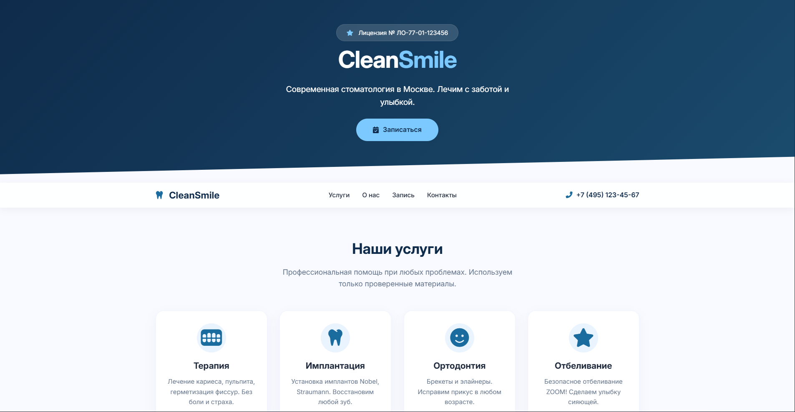
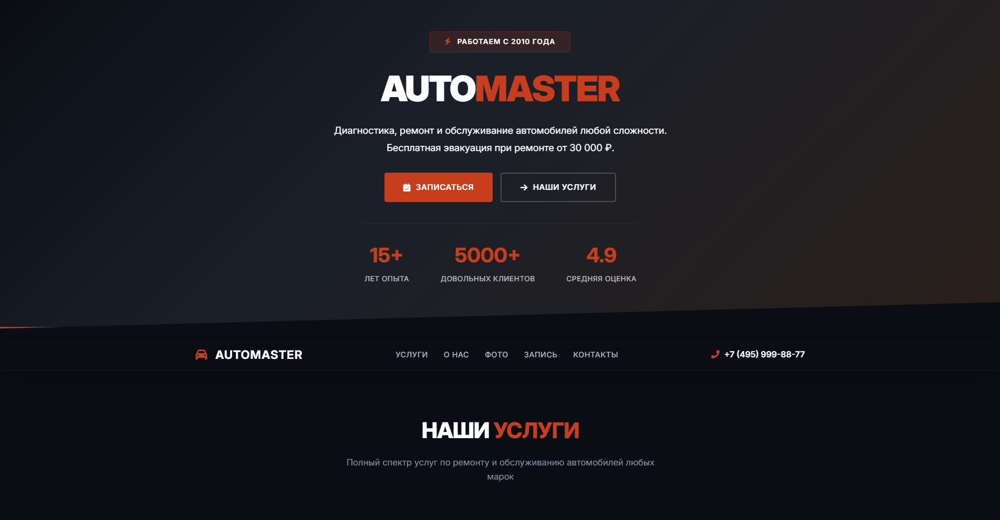
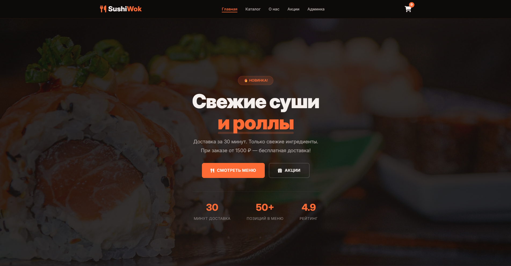
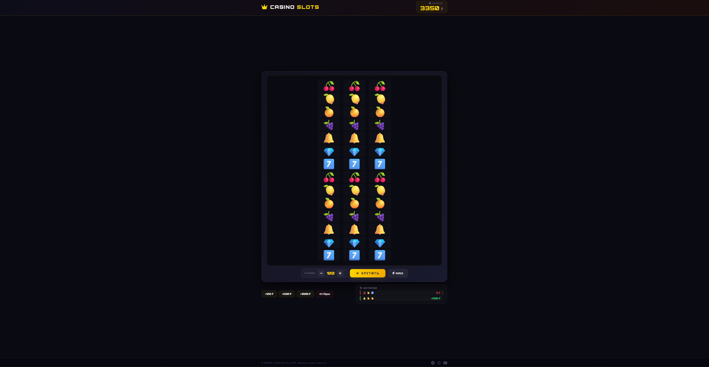
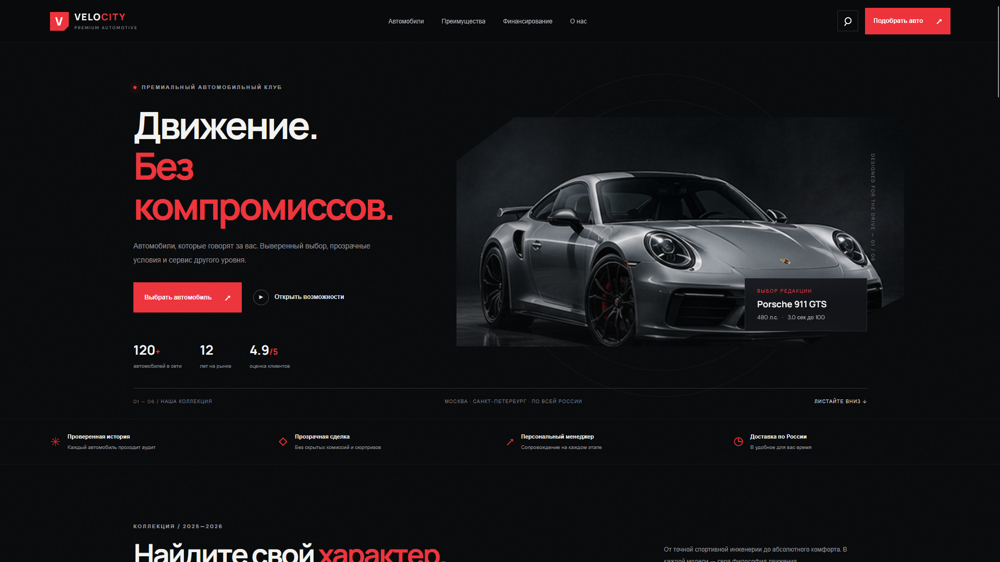

<div align="center">

# 🎯 Web Works

### Портфолио веб-разработчика • Web Developer Portfolio


**5 проектов. 5 направлений. 5 разных визуальных стилей.**  
**5 projects. 5 industries. 5 distinct visual styles.**

</div>

---

## 📖 О репозитории • About

**Русский**

**Web Works** — коллекция из пяти frontend-проектов, созданных для разных сфер: стоматология, автосервис, премиальный автомобильный шоурум, суши-ресторан и игровое слот-приложение.

У каждого проекта собственная визуальная система и набор функций. В репозитории есть светлый минималистичный сайт клиники, брутальный сайт автосервиса, премиальный тёмный шоурум **VELOCITY**, интерактивный каталог суши с корзиной и демо-админкой, а также слот-игра с балансом и историей вращений.

**English**

**Web Works** is a collection of five frontend projects for different industries: a dental clinic, an auto service, a premium automotive showroom, a sushi restaurant, and a slot game.

Each project has its own visual style and feature set. The repository includes a light minimalist clinic website, a bold auto service website, the premium dark **VELOCITY** showroom, an interactive sushi menu with a cart and demo admin panel, and a slot game with a balance and spin history.

---

## 📸 Скриншоты • Screenshots

| 🦷 CleanSmile | 🚗 AutoMaster | 🍣 SushiWok |
|---|---|---|
|  |  |  |

| 🎰 Casino Slots | 🚗 Velocity |
|---|---|
|  |  |

</div>

---

## 📁 Проекты • Projects

### 🦷 1. CleanSmile — Сайт стоматологии • Dental Clinic

Светлый и аккуратный сайт стоматологической клиники с акцентом на доверие, понятную подачу услуг и запись на приём.

*A clean, light dental clinic website focused on trust, clear service information, and appointment booking.*

| 🇷🇺 Русский | 🇬🇧 English |
|---|---|
| 🏥 Светлый минималистичный дизайн | 🏥 Light minimalist design |
| ✨ Плавные анимации при прокрутке | ✨ Smooth scroll animations |
| 📝 Форма записи с валидацией | 📝 Appointment form with validation |
| 📱 Адаптивная вёрстка | 📱 Responsive layout |

**Папка проекта • Project folder:** [`dental/`](dental/)

---

### 🚗 2. AutoMaster — Сайт автосервиса • Auto Service

Сайт автосервиса с брутальным тёмным оформлением и оранжевыми акцентами.

*An auto service website with a bold dark design and orange accents.*

| 🇷🇺 Русский | 🇬🇧 English |
|---|---|
| ⚫ Тёмный брутальный стиль | ⚫ Bold dark visual style |
| 🟠 Оранжевый акцентный цвет | 🟠 Orange accent color |
| 🖼️ Галерея работ с оверлеем | 🖼️ Work gallery with overlays |
| 🗺️ Интерактивная карта при настроенном API | 🗺️ Interactive map when API is configured |
| 📊 Статистика в шапке | 📊 Header statistics |

**Папка проекта • Project folder:** [`auto/`](auto/)

---

### 🏎️ 3. VELOCITY — Premium Automotive

Премиальный автомобильный шоурум с тёмным интерфейсом, красными акцентами и интерактивным каталогом. Проект помогает изучать автомобили, сравнивать варианты и оценивать примерные условия финансирования.

*A premium automotive showroom with a dark interface, red accents, and an interactive vehicle catalog. Visitors can explore vehicles, compare options, and estimate financing scenarios.*

| 🇷🇺 Русский | 🇬🇧 English |
|---|---|
| 🖤 Премиальный тёмный дизайн с красными акцентами | 🖤 Premium dark design with red accents |
| 🚘 Каталог автомобилей | 🚘 Vehicle catalog |
| 🔎 Поиск и фильтры по категории, марке и бюджету | 🔎 Search and filters by category, brand, and budget |
| ↕️ Сортировка автомобилей | ↕️ Vehicle sorting |
| ❤️ Избранное с сохранением в браузере | ❤️ Favorites saved in the browser |
| ⚖️ Сравнение до трёх автомобилей | ⚖️ Compare up to three vehicles |
| 💳 Калькулятор кредита и лизинга | 💳 Loan and lease calculator |
| 🖼️ Галерея автомобилей с переключением изображений | 🖼️ Vehicle image gallery with navigation |
| 🛠️ Демо-инструменты управления каталогом | 🛠️ Demo catalog management tools |
| 📩 Демо-форма заявки на тест-драйв | 📩 Demo test-drive inquiry form |
| 📱 Адаптивная вёрстка и мобильная навигация | 📱 Responsive layout and mobile navigation |

**Папка проекта • Project folder:** [`velocity/`](velocity/)

---

### 🍣 4. SushiWok — Сайт суши-ресторана • Sushi Restaurant

Сайт суши-ресторана с каталогом блюд, корзиной и отдельной демо-админкой для управления позициями меню.

*A sushi restaurant website with a dish catalog, shopping cart, and a separate demo admin panel for managing menu items.*

| 🇷🇺 Русский | 🇬🇧 English |
|---|---|
| 🍣 Каталог с фильтрацией | 🍣 Filterable menu catalog |
| 🛒 Корзина с подсчётом стоимости | 🛒 Shopping cart with price totals |
| 🔐 Демо-админ-панель | 🔐 Demo admin panel |
| 📦 CRUD-операции с товарами | 📦 CRUD product management |
| 💾 Локальное хранение данных через `localStorage` | 💾 Local data storage with `localStorage` |
| 🌙 Тёмная тема со стеклянными эффектами | 🌙 Dark theme with glass effects |

**Папка проекта • Project folder:** [`sushiwok/`](sushiwok/)

---

### 🎰 5. Casino Slots — Игровой слот • Slot Game

Интерактивная слот-игра с тремя барабанами, регулируемой ставкой, демонстрационным балансом и историей последних вращений.

*An interactive slot game with three reels, adjustable bets, a demo balance, and recent spin history.*

| 🇷🇺 Русский | 🇬🇧 English |
|---|---|
| 🎡 Три барабана и семь символов | 🎡 Three reels and seven symbols |
| 💰 Баланс с сохранением | 💰 Persistent balance |
| 🎲 Настройка размера ставки | 🎲 Bet adjustment |
| 🏆 Выигрыши с множителями | 🏆 Wins with multipliers |
| 💵 Демонстрационное пополнение баланса | 💵 Demo balance top-up |
| 📜 История последних вращений | 📜 Recent spin history |
| ⌨️ Управление с клавиатуры | ⌨️ Keyboard controls |

**Папка проекта • Project folder:** [`slots/`](slots/)

---

## 🛠️ Технологии • Tech Stack

| Технология • Technology | Использование • Purpose |
|---|---|
| **HTML5** | Семантическая структура страниц • Semantic page structure |
| **CSS3** | Дизайн, адаптивность, темы и анимации • Styling, responsiveness, themes, and animations |
| **JavaScript (ES6+)** | Интерактивность, фильтры, формы и UI-логика • Interactivity, filters, forms, and UI logic |
| **`localStorage`** | Локальное сохранение данных там, где предусмотрено • Local persistence where implemented |
| **Font Awesome** | Иконки в проектах, где библиотека подключена • Icons where included |
| **Google Fonts** | Шрифты в проектах, где подключены • Typography where included |
| **Yandex Maps API** | Карты в проектах с настроенной интеграцией • Maps in projects with API integration |

Проекты используют обычные HTML, CSS и JavaScript. Для запуска не требуется единая сборка или установка frontend-фреймворка.

The projects use standard HTML, CSS, and JavaScript. No shared build step or frontend framework installation is required.

---

## 🚀 Запуск проектов • Running the Projects

### 🇷🇺 Русский

1. Скачай или клонируй репозиторий.
2. Выбери папку нужного проекта: `dental/`, `auto/`, `velocity/`, `sushiwok/` или `slots/`.
3. Открой `index.html` в современном браузере.
4. Если проект использует внешний API или веб-шрифты, некоторым функциям может понадобиться подключение к интернету.
5. Для удобной локальной разработки можно открыть папку проекта в VS Code и использовать **Live Server**.

### 🇬🇧 English

1. Download or clone the repository.
2. Choose a project folder: `dental/`, `auto/`, `velocity/`, `sushiwok/`, or `slots/`.
3. Open `index.html` in a modern browser.
4. If a project uses an external API or web fonts, some features may require an internet connection.
5. For convenient local development, open the project in VS Code and use **Live Server**.

---

## 📦 Установка • Installation

```bash
# Clone the repository
git clone https://github.com/kiru0real/web-works.git

# Enter the repository
cd web-works
```

Затем открой папку проекта и запусти её `index.html`. Например, для VELOCITY:

Then open the selected project folder and launch its `index.html`. For VELOCITY:

```bash
cd velocity
```

---

## 🗺️ Настройка API-ключей • API Key Setup

Если в AutoMaster или SushiWok используется **Yandex Maps API**, может понадобиться собственный API-ключ.

If AutoMaster or SushiWok uses the **Yandex Maps API**, you may need your own API key.

1. Перейди на [Yandex Maps Developer](https://developer.tech.yandex.ru/).
2. Создай приложение и получи ключ согласно требованиям сервиса.
3. В HTML-файле карты замени placeholder на свой ключ.
4. Не публикуй приватные ключи и не добавляй секреты в репозиторий.

1. Visit [Yandex Maps Developer](https://developer.tech.yandex.ru/).
2. Create an application and obtain a key according to the service requirements.
3. Replace the placeholder in the relevant map HTML file.
4. Do not publish private keys or commit secrets to the repository.

Пример подключения • Example integration:

```html
<script src="https://api-maps.yandex.ru/2.1/?apikey=YOUR_API_KEY&lang=ru_RU" type="text/javascript"></script>
```

---

## 📂 Структура репозитория • Repository Structure

```text
web-works/
├── README.md
├── LICENSE
├── dental/
│   ├── index.html
│   ├── style.css
│   └── script.js
├── auto/                       # AutoMaster — auto service
│   ├── index.html
│   ├── style.css
│   ├── script.js
│   └── img/
├── velocity/                   # VELOCITY — Premium Automotive
│   ├── index.html
│   ├── styles.css
│   ├── app.js
│   └── assets/
├── sushiwok/
│   ├── index.html
│   ├── catalog.html
│   ├── admin.html
│   ├── style.css
│   ├── script.js
│   └── img/
├── slots/
│   ├── index.html
│   ├── style.css
│   └── script.js
└── screenshots/
    ├── dental-preview.png
    ├── auto-preview.png
    ├── velocity-preview.png
    ├── sushi-preview.png
    └── slots-preview.png
```

> Если фактические имена папок или файлов отличаются, обнови пути в этом README под реальную структуру репозитория. Папку сайта VELOCITY можно назвать `velocity/`, чтобы ссылка выше работала без изменений.

> If your actual folder or filenames differ, update the paths in this README to match your repository. Name the VELOCITY folder `velocity/` to keep the link above working as written.

---

## 🎮 Casino Slots — Управление • Controls

| Клавиша • Key | Действие • Action |
|---|---|
| `Enter` | Крутить барабаны • Spin the reels |
| `↑` | Увеличить ставку • Increase the bet |
| `↓` | Уменьшить ставку • Decrease the bet |
| `Esc` | Закрыть попап, если он открыт • Close a popup if one is open |

---

## 🔐 Демо-админка SushiWok • SushiWok Demo Admin

Если в текущей версии проекта используется демо-вход, параметры для локальной демонстрации могут быть такими:

If the current project version uses demo login credentials, the local demo access may be:

| Поле • Field | Значение • Value |
|---|---|
| Логин • Username | `admin` |
| Пароль • Password | `admin123` |

> Это только демонстрационные данные. Клиентская проверка пароля не обеспечивает настоящую защиту. Не используй эту схему для реального проекта и не храни в нём чувствительные данные.

> These are demo credentials only. Client-side password checks do not provide real security. Do not use this pattern for a production project or store sensitive data in it.

---

## ⚠️ Важные замечания • Important Notes

- Проекты предназначены для портфолио и демонстрации frontend-навыков.
- Данные каталога и цены VELOCITY могут быть демонстрационными и не представляют актуальное предложение автосалона.
- Демо-админки и данные в `localStorage` работают на стороне браузера и не заменяют защищённый backend.
- Для реальной отправки заявок требуется backend или интеграция с сервисом форм.
- Внешние API, карты и веб-шрифты могут требовать подключения к сети и действительных ключей.
- Перед production-развёртыванием необходимо добавить серверную авторизацию, проверку данных и безопасную обработку пользовательского ввода.

- These projects are intended to showcase frontend skills.
- VELOCITY inventory and prices may be demo data and do not represent a live dealership offer.
- Demo admin panels and `localStorage` data run in the browser and are not a secure backend.
- Real inquiry submission requires a backend or form-service integration.
- External APIs, maps, and web fonts may require an internet connection and valid keys.
- Before production deployment, add server-side authentication, data validation, and secure handling of user input.

---

## 🤝 Вклад • Contributing

Предложения и улучшения приветствуются.

Contributions and improvements are welcome.

1. Сделай fork репозитория • Fork the repository.
2. Создай feature-ветку • Create a feature branch.
3. Внеси и протестируй изменения • Make and test your changes.
4. Создай commit и push • Commit and push your changes.
5. Открой Pull Request • Open a Pull Request.

---

## 📝 Лицензия • License

В репозитории предусмотрен файл [`LICENSE`](LICENSE). Перед повторным использованием кода проверь его содержимое и соблюдай указанные условия.

The repository includes a [`LICENSE`](LICENSE) file. Review its contents before reusing the code and follow the stated terms.

---

## 👤 Автор • Author

**Кирилл • Kirill**

- GitHub: [@kiru0real](https://github.com/kiru0real)
- Telegram: [@pufikreal](https://t.me/pufikreal)
- Email: [itskiru@icloud.com](mailto:itskiru@icloud.com)

---

## 🙏 Благодарности • Acknowledgments

- [Unsplash](https://unsplash.com) — фотографии там, где используются внешние изображения • photos where external images are used
- [Pexels](https://www.pexels.com/) — фотографии • photos
- [Font Awesome](https://fontawesome.com/) — иконки • icons
- [Google Fonts](https://fonts.google.com/) — шрифты • fonts
- [Yandex Maps Developer](https://developer.tech.yandex.ru/) — карта в проектах с API-интеграцией • maps for projects with API integration

---

<div align="center">

**⭐ Если тебе понравились проекты — поставь звезду репозиторию!**  
**⭐ If you like the projects, give the repository a star!**

</div>
